

  Avaliação • Metodologias (Etapas 1 a 7)
  <h1>Metodologias Utilizadas</h1>
  
Protocolo técnico completo aplicado nas 7 etapas da avaliação do site da Apple Brasil (apple.com/br), combinando inspeção manual de código (DOM/CSS), ferramentas automatizadas, testes de teclado, leitor de tela e percurso heurístico com evidências visuais.

## Visão geral

Cada uma das **7 etapas do checklist (103 critérios)** foi avaliada mantendo a ordem original dos critérios e registrando o nível WCAG (A, AA ou AAA) ou a respectiva Heurística de Nielsen. Para garantir rigor técnico além da simples marcação de *checkboxes*, aplicamos as **6 categorias de ferramentas** documentadas na seção [Ferramentas](../ferramentas/devtools.md) sobre fluxos reais de `apple.com/br`. Os resultados foram classificados como **atendido**, **pendente** (não atende ou apresenta falha parcial na amostra) ou **não se aplica**.

!!! note "Critérios de decisão"
    - **Falha medida em amostra:** há medição, inspeção de DOM ou teste específico que reprova o elemento observado (ex.: alvo de clique de 8×8 px, ausência de `lang="en"` ou razão de contraste de 3,48:1).
    - **Evidência favorável em amostra:** o critério foi comprovado nos fluxos testados (ex.: `<html lang="pt-BR">`, refluxo em 320 px sem rolagem horizontal, validação textual e visual de erro de CEP).
    - **Parcial ou inconclusivo:** quando um requisito falha em parte de um fluxo, não é aprovado isoladamente em respeito ao critério de conformidade em processos completos.

---

## Etapa 1 — Visão Geral, Blueprint da Jornada e Conformidade Global

  

    🗺️
    
<h2>Diagnóstico Global (Lighthouse) e Percurso de UI / Service Blueprint</h2>

  

  
Avaliação macro da proposta de valor (UX/UI), organização espacial das zonas da interface (UI Blueprint), continuidade do fluxo de compra ponta a ponta (Service Blueprint) e verificação de não-interferência.

  

    

      <h3>Ferramentas</h3>
      <ul>
        <li><strong>Google Lighthouse (Chrome DevTools)</strong> para diagnóstico automatizado inicial de acessibilidade e boas práticas.</li>
        <li><strong>Inspeção de Jornada (Service Blueprint)</strong> percorrendo os 5 passos do fluxo de compra em desktop e mobile.</li>
      </ul>
    

    

      <h3>Procedimentos</h3>
      <ul>
        <li>Execução do auditor <strong>Lighthouse</strong> sobre a página inicial (<code>https://www.apple.com/br/</code>).</li>
        <li>Percurso completo do usuário: 1) Página inicial → 2) Vitrine da família iPhone → 3) Configuração de capacidade e preço → 4) Adição e recomendação de acessórios → 5) Revisão da sacola de compras.</li>
        <li>Verificação de banners, animações e botão flutuante de especialista quanto ao bloqueio de leitura ou foco.</li>
      </ul>
    

  

### Evidências e conclusões — Etapa 1

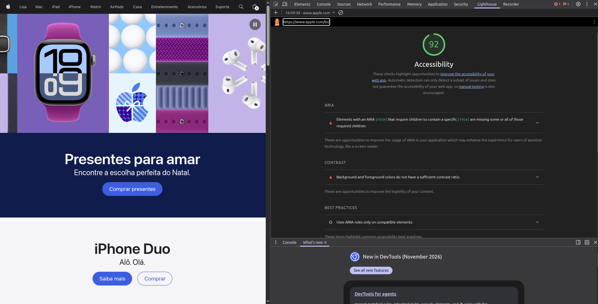
*Figura 1.1 — Diagnóstico inicial com o Google Lighthouse em `apple.com/br`: pontuação 92/100 em Acessibilidade, sinalizando oportunidades de correção em atributos ARIA e em taxas de contraste.*

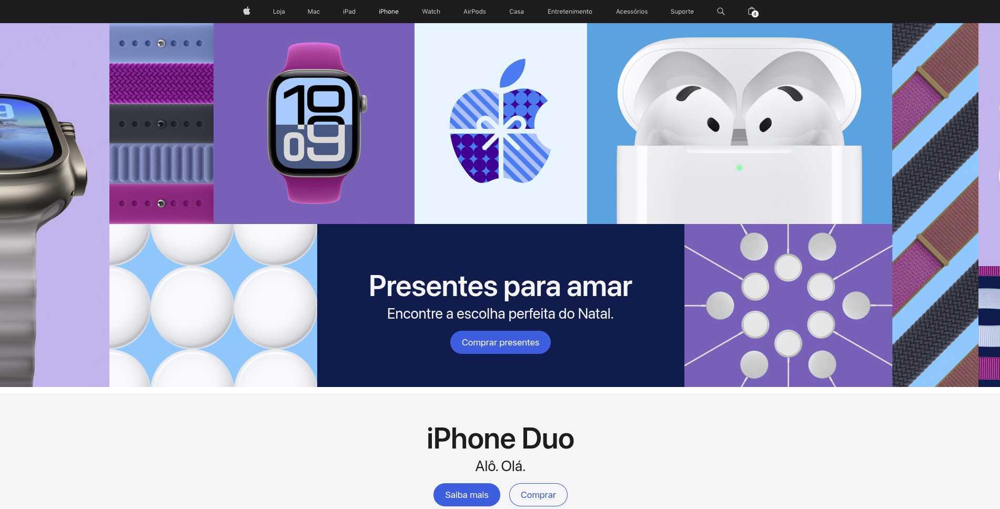
*Figura 1.2 — Início da jornada na página principal: proposta de valor imediata, hierarquia visual clara (UI Blueprint) e chamadas para ação ("Comprar presentes", "Saiba mais" e "Comprar") sem pop-ups intrusivos.*

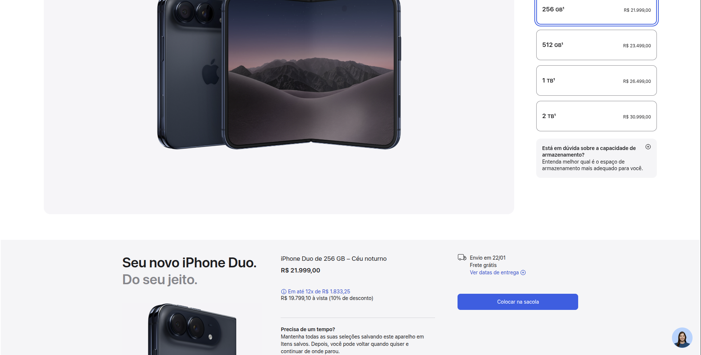
*Figura 1.3 — Continuidade do Service Blueprint na configuração do aparelho (256 GB a 2 TB): o resumo de preço e prazo de entrega atualiza dinamicamente e o ícone de suporte flutuante no canto inferior direito não bloqueia o conteúdo principal.*

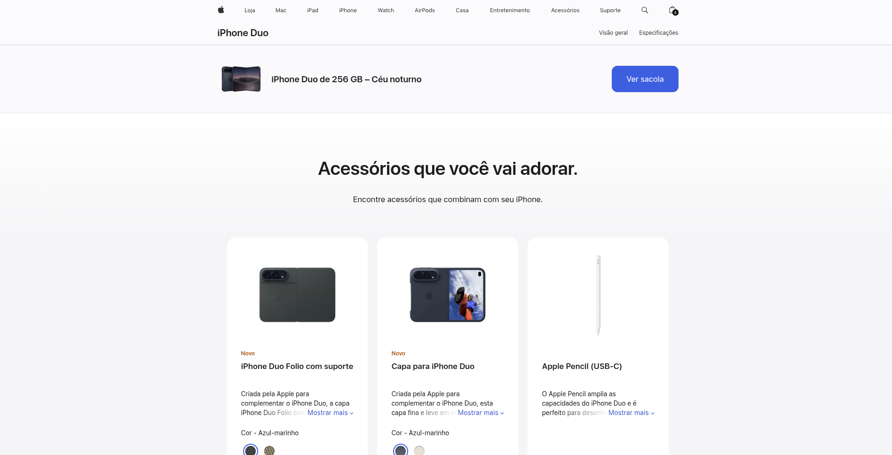
*Figura 1.4 — Retorno claro das ações do sistema após configurar o modelo ("iPhone Duo de 256 GB – Céu noturno" com botão direto "Ver sacola"), garantindo transição contínua sem becos sem saída.*

!!! success "Conclusão fundamentada da Etapa 1 (5 de 6 critérios atendidos — 83%)"
    O portal apresenta excelente arquitetura da informação (*UI Blueprint*) e continuidade ponta a ponta no fluxo de compra (*Service Blueprint*), sem janelas modais ou *pop-ups* bloqueando a navegação. O único critério não atendido nesta etapa é a **Conformidade Integral em Processos Completos**, pois — como demonstrado pelo alerta inicial do Lighthouse (nota 92) e confirmado nas etapas seguintes — há falhas pontuais de nível A e AA (como ausência de *skip link* e contrastes abaixo de 4,5:1) ao longo das telas do fluxo.

---

## Etapa 2 — Estrutura, Semântica e Compatibilidade (HTML / ARIA)

  

    🧱
    
<h2>Inspeção do DOM, Landmarks, Idioma e Árvore de Acessibilidade</h2>

  

  
Auditoria direta do código HTML5 e dos atributos WAI-ARIA no navegador para validar como a estrutura da página é entregue aos leitores de tela.

  

    

      <h3>Ferramentas</h3>
      <ul>
        <li><strong>Browser DevTools (aba Elements e Accessibility)</strong> para inspecionar a árvore do DOM e propriedades semânticas.</li>
        <li><strong>WAVE (WebAIM)</strong> para conferência das <em>landmarks</em>, cabeçalhos (<code>H1–H6</code>) e 249 atributos ARIA mapeados.</li>
      </ul>
    

    

      <h3>Procedimentos</h3>
      <ul>
        <li>Verificação da declaração programática do idioma principal na tag raiz <code>&lt;html&gt;</code> e da tag <code>&lt;title&gt;</code>.</li>
        <li>Inspeção das regiões principais (<code>&lt;nav&gt;</code>, <code>&lt;main role="main"&gt;</code>, <code>&lt;footer role="contentinfo"&gt;</code>) e do <code>&lt;h1&gt;</code> da página.</li>
        <li>Inspeção de links, títulos de séries e termos em inglês distribuídos na interface em português para checar a marcação de idioma de trechos (critério 3.1.2 — Nível AA).</li>
      </ul>
    

  

### Evidências e conclusões — Etapa 2

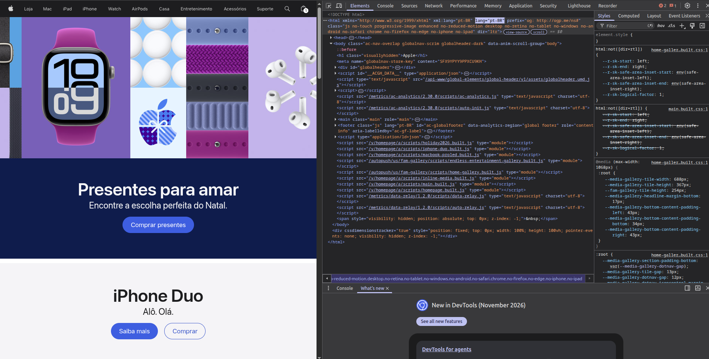
*Figura 2.1 — Inspeção no DevTools comprovando a declaração correta do idioma principal (`xml:lang="pt-BR" lang="pt-BR"`), presença de cabeçalho principal `<h1 class="visuallyhidden">Apple</h1>` para tecnologias assistivas e uso de tags semânticas `<main class="main" role="main">` e `<footer role="contentinfo">`.*

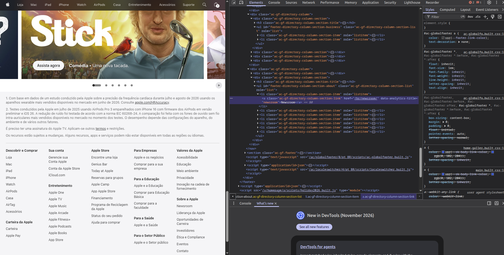
*Figura 2.2 — Falha identificada no Nível AA (Idioma de Partes — WCAG 3.1.2): termos em língua inglesa como o banner "Stick" e o link `<a ...>Newsroom</a>` no rodapé estão inseridos diretamente no documento `pt-BR` sem o atributo `lang="en"`, fazendo com que leitores de tela os pronunciem com fonética portuguesa.*

!!! info "Conclusão fundamentada da Etapa 2 (10 de 11 critérios atendidos — 91%)"
    A engenharia semântica do site da Apple Brasil é altamente robusta no **Nível A** (100% de aprovação neste nível dentro da etapa): há título descritivo, idioma principal declarado, *landmarks* bem definidas, ordem lógica no DOM e notificações de estado via ARIA. A única reprovação ocorreu no critério de **Nível AA (3.1.2 — Idioma de Partes)**, documentada na Figura 2.2, pela ausência de `lang="en"` em expressões estrangeiras.

---

## Etapa 3 — Navegação, Teclado, Foco e Interação

  

    ⌨️
    
<h2>Testes de Operabilidade por Teclado, Foco Visível e Tamanho do Alvo</h2>

  

  
Verificação prática da navegação sequencial por teclado sem uso do mouse e medição em CSS pixels da área de clique/toque dos controles interativos.

  

    

      <h3>Ferramentas</h3>
      <ul>
        <li><strong>Navegação exclusiva por Teclado</strong> (<code>Tab</code>, <code>Shift + Tab</code>, <code>Enter</code>, <code>Espaço</code> e <code>ESC</code>).</li>
        <li><strong>Seletor de Inspeção do DevTools (<code>Ctrl + Shift + C</code>)</strong> com overlay de dimensões em pixels e diagnóstico de <em>Keyboard-focusable</em>.</li>
      </ul>
    

    

      <h3>Procedimentos</h3>
      <ul>
        <li>Acionamento da tecla <code>Tab</code> a partir do carregamento da página para verificar o estilo de foco (<code>:focus-visible</code>) e se existe atalho para pular o menu principal (<em>skip link</em>).</li>
        <li>Medição das dimensões em pixels de botões de navegação, indicadores de paginação de carrosséis e controles de compra em relação aos limites de <strong>24×24 px (Nível AA)</strong> e <strong>44×44 px (Nível AAA)</strong>.</li>
      </ul>
    

  

### Evidências e conclusões — Etapa 3

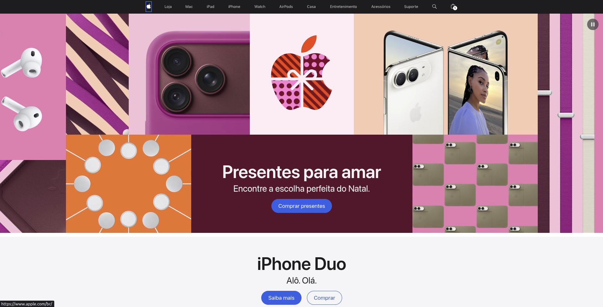
*Figura 3.1 — Teste com a tecla `Tab`: o primeiro foco vai diretamente para o logotipo da Apple na barra de navegação superior (com anel azul de foco `:focus-visible`), evidenciando a ausência de um link visível de atalho "Pular para o conteúdo principal" (WCAG 2.4.1).*

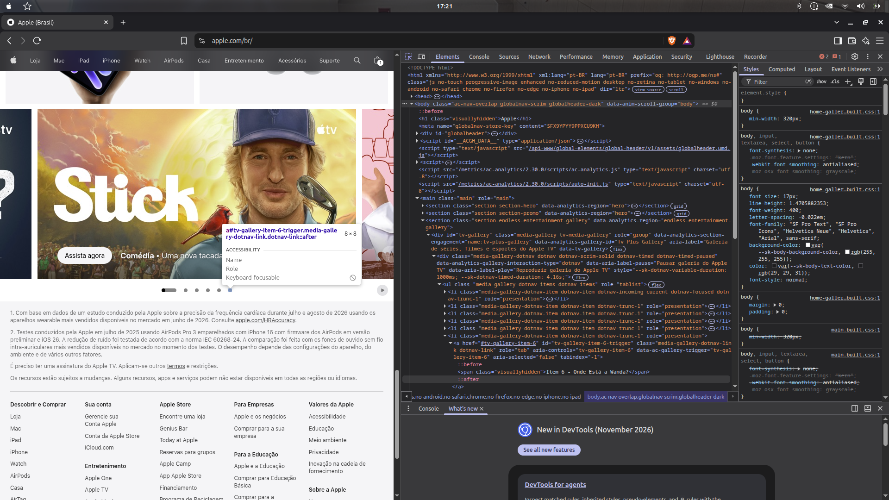
*Figura 3.2 — Inspeção dos botões de paginação (dotnav) do carrossel da Apple TV+ no DevTools: o indicador mede apenas **8 × 8 CSS pixels** e apresenta `tabindex="-1"` (`Keyboard-focusable: ⊘`), ficando abaixo do mínimo de 24×24 px (Nível AA) e de 44×44 px (Nível AAA).*

!!! warning "Conclusão fundamentada da Etapa 3 (13 de 19 critérios atendidos — 68%)"
    Embora as funcionalidades centrais não possuam armadilhas de teclado (*keyboard traps*) e os modais respeitem a tecla `ESC`, os testes empíricos revelaram barreiras importantes de navegação:
    1. Ausência de link de atalho para pular blocos repetidos no topo da página;
    2. Indicadores de foco que nem sempre mantêm destaque uniforme em todos os componentes;
    3. Controles secundários (como os indicadores de carrossel de **8×8 px** na Figura 3.2 e botões de topo de **31×44 px**) que não atingem os tamanhos mínimos de alvo de toque/clique da WCAG 2.2 e da ABNT NBR 17060.

---

## Etapa 4 — Design, Cores, Contraste e Responsividade

  

    🎨
    
<h2>Inspeção Manual Assistida por WAVE, WebAIM Contrast Checker e DevTools</h2>

  

  
Coleta realizada sobre a página inicial, o fluxo de compra do iPhone Duo e a página de recursos de acessibilidade para auditar contraste cromático, uso de cor, zoom de 200% e refluxo responsivo em 320 px.

  

    

      <h3>Ferramentas</h3>
      <ul>
        <li><strong>WAVE (WebAIM)</strong> para mapear automaticamente pontos de baixo contraste na página.</li>
        <li><strong>WebAIM Contrast Checker</strong> para aferição matemática da razão de contraste entre cor de texto (<em>Foreground</em>) e fundo (<em>Background</em>).</li>
        <li><strong>DevTools Device Toolbar</strong> para emulação de tela mobile em <strong>320 px</strong> de largura (Refluxo) e alternância retrato/paisagem.</li>
        <li><strong>WCAG Tester</strong> para o teste de espaçamento de texto (critério 1.4.12).</li>
      </ul>
    

    

      <h3>Procedimentos</h3>
      <ul>
        <li>Varredura da página inicial no <strong>WAVE</strong> identificando os alertas de contraste e estrutura.</li>
        <li>Aferição no <strong>WebAIM Contrast Checker</strong> dos textos secundários cinzas (<code>#89898D</code>) sobre fundo branco (<code>#FFFFFF</code>).</li>
        <li>Redimensionamento da viewport para <strong>320 CSS pixels</strong> de largura e zoom a <strong>200%</strong> para verificar se há corte de conteúdo ou barra de rolagem horizontal.</li>
      </ul>
    

  

### Evidências e conclusões — Etapa 4

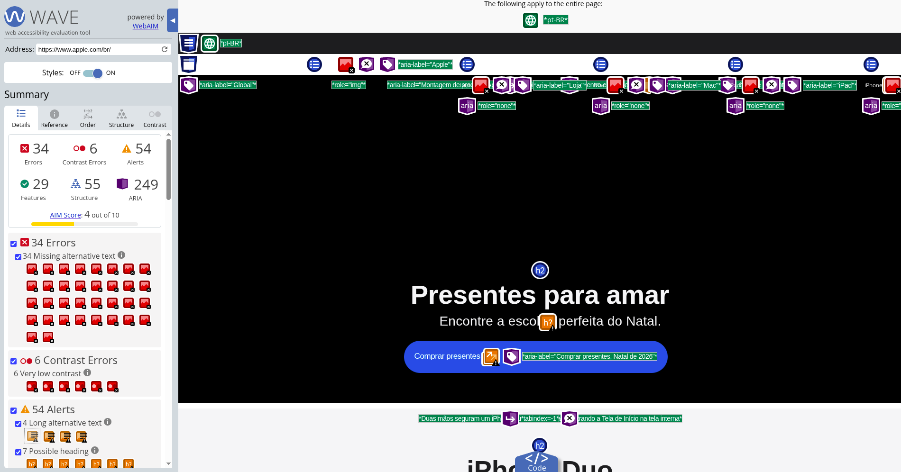
*Figura 4.1 — Auditoria da página inicial `apple.com/br` na ferramenta WAVE (WebAIM), que apontou **6 erros de contraste muito baixo (Very low contrast)**, além de mapear 29 features de acessibilidade, 55 elementos estruturais e 249 atributos ARIA.*

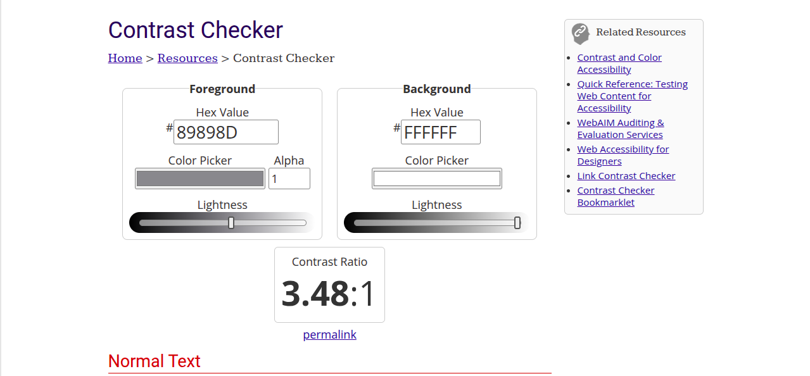
*Figura 4.2 — Medição no WebAIM Contrast Checker da cor de texto secundário (`#89898D`) sobre fundo branco (`#FFFFFF`), resultando em razão de contraste de **3,48:1** — reprovada tanto no **Nível AA (mínimo 4,5:1)** quanto no **Nível AAA (mínimo 7:1)** para texto normal.*

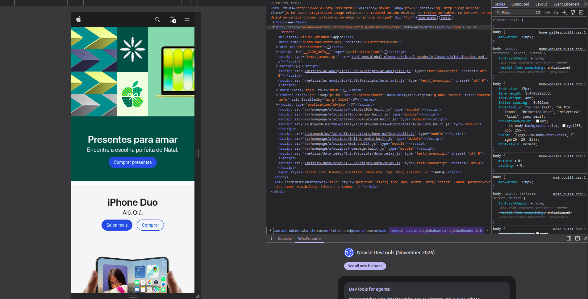
*Figura 4.3 — Emulação de largura de **320 CSS pixels** (`min-width: 320px`) no DevTools: o layout se reorganiza perfeitamente em coluna única vertical, mantendo imagens, títulos e botões ("Comprar presentes", "Saiba mais", "Comprar") legíveis e sem exigir rolagem horizontal.*

!!! warning "Conclusão fundamentada da Etapa 4 (7 de 13 critérios atendidos — 54%)"
    O site da Apple se destaca positivamente em **Responsividade e Layout Adaptável**: passou integralmente nos testes de **Refluxo em 320 px** (Figura 4.3), **Zoom de 200%**, **Orientação Retrato/Paisagem**, **Espaçamento de Texto** e **Uso de Texto Real em vez de Imagens de Texto**. Em contrapartida, a estética minimalista com uso frequente de tipografia cinza-claro sobre fundos claros levou à reprovação nos critérios de **Contraste Mínimo AA (4,5:1)** e **Contraste Aprimorado AAA (7:1)**, com medição comprovada de **3,48:1** (Figuras 4.1 e 4.2) — ponto que também foi citado pela participante P1 na entrevista como uma das maiores dificuldades de leitura.

---

## Etapa 5 — Formulários, Previsibilidade, Segurança e Limites de Tempo

  

    📝
    
<h2>Testes Empíricos de Formulários, Prevenção de Erros e Sessão</h2>

  

  
Análise dos formulários de busca, cálculo de frete por CEP na sacola, checkout e autenticação (Apple ID), combinando inspeção de código com simulações de erro e testes em leitor de tela.

  

    

      <h3>DevTools (aba Elements)</h3>
      <ul>
        <li>Validação da associação de rótulos (<code>&lt;label&gt;</code>), <code>aria-label</code> e atributos <code>autocomplete</code>.</li>
        <li>Conferência de marcações de autenticação acessível e suporte a gerenciadores de senha / biometria (<code>webauthn</code>).</li>
      </ul>
    

    

      <h3>Leitor de tela e teclado</h3>
      <ul>
        <li>Testes com <strong>TalkBack no Android 15</strong> e navegação por teclado em desktop.</li>
        <li>Verificação de anúncio de erro, foco no campo inválido e ausência de mudança inesperada de contexto ao digitar.</li>
      </ul>
    

    

      <h3>Sessão e carga cognitiva</h3>
      <ul>
        <li>Inserção proposital de CEP inválido (<code>99999-9999</code>) na sacola para verificar a mensagem de erro e sugestões de correção.</li>
        <li>Verificação da persistência dos itens na sacola após inatividade e opção de salvar localização para evitar redigitação (Entrada Redundante — WCAG 3.3.7).</li>
      </ul>
    

  

### Evidências e conclusões — Etapa 5

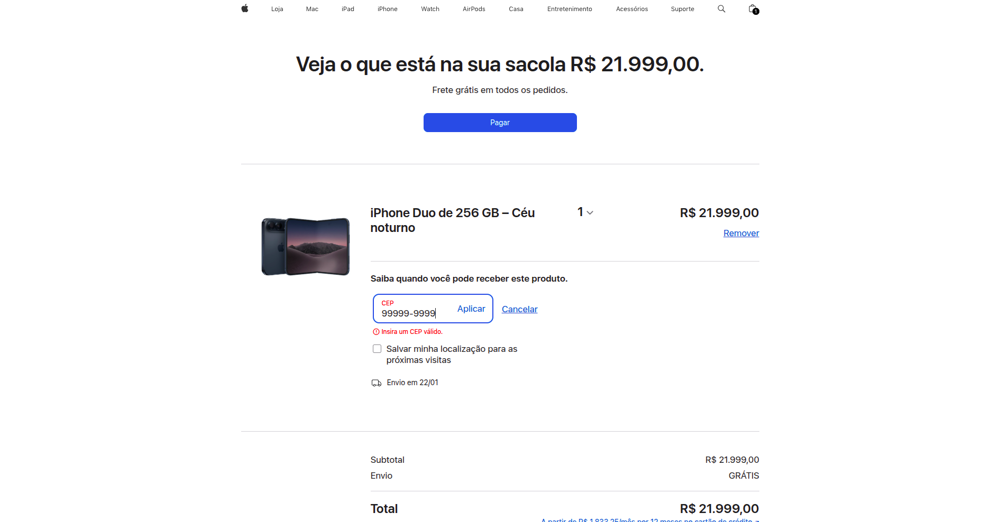
*Figura 5.1 — Simulação de erro no formulário de frete da sacola com o CEP `99999-9999`: o sistema destaca a borda do campo, preserva o valor digitado, exibe ícone de alerta `!` + mensagem textual clara ("Insira um CEP válido.") logo abaixo do input (atendendo simultaneamente aos critérios 1.4.1, 3.3.1 e 3.3.3) e oferece a caixa "Salvar minha localização para as próximas visitas" (evitando redigitação na sessão).*

!!! success "Conclusão fundamentada da Etapa 5 (17 de 17 critérios atendidos — 100%)"
    A Etapa 5 obteve **100% de aprovação**. Os formulários de compra e login da Apple Brasil seguem rigorosamente as diretrizes de previsibilidade, rotulagem programática, recuperação de erros sem perda dos dados preenchidos, autenticação acessível (permitindo colar senha e usar chaves-senha/biometria sem desafios cognitivos bloqueantes) e preservação do carrinho de compras sem expiração abrupta de tempo.

---

## Etapa 6 — Conteúdo Textual, Imagens, Áudio, Vídeo e Animações

  

    🎬
    
<h2>Auditoria de Nomes Acessíveis, Imagens, Mídia e Controle de Animações</h2>

  

  
Inspeção de textos alternativos em imagens, botões compostos apenas por ícones, vídeos promocionais e carrosséis animados nas páginas de produto.

  

    

      <h3>Ferramentas</h3>
      <ul>
        <li><strong>DevTools Accessibility Inspector</strong> para verificar o <em>Computed Name</em> e <em>Role</em> de botões de ícone e imagens.</li>
        <li><strong>Inspeção manual de controles de mídia</strong> nos banners animados e galerias de produtos.</li>
      </ul>
    

    

      <h3>Procedimentos</h3>
      <ul>
        <li>Inspeção dos botões de ícone do cabeçalho global (como a Lupa de busca e a Sacola) para confirmar se anunciam sua ação em vez da aparência do ícone.</li>
        <li>Verificação da existência de botões visíveis para <strong>Pausar / Reproduzir</strong> animações e vídeos que iniciam automaticamente por mais de 5 segundos (critério 2.2.2 — Nível A).</li>
        <li>Conferência de recursos avançados de mídia do Nível AAA (como janela de tradução em Libras nos vídeos institucionais).</li>
      </ul>
    

  

### Evidências e conclusões — Etapa 6

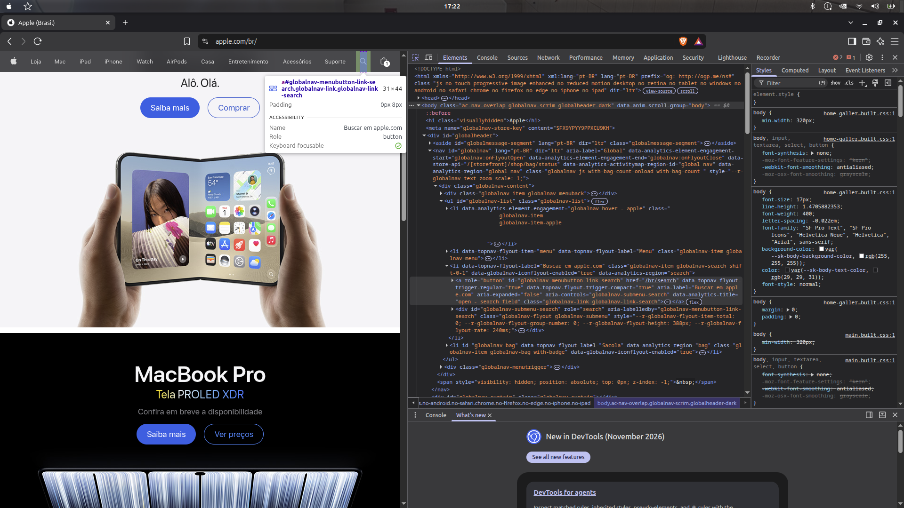
*Figura 6.1 — Inspeção do botão de ícone da Lupa no cabeçalho com o DevTools: o painel de acessibilidade confirma `Name: "Buscar em apple.com"`, `Role: button` e `Keyboard-focusable: ✓`, descrevendo claramente a finalidade da ação para leitores de tela e comando de voz.*

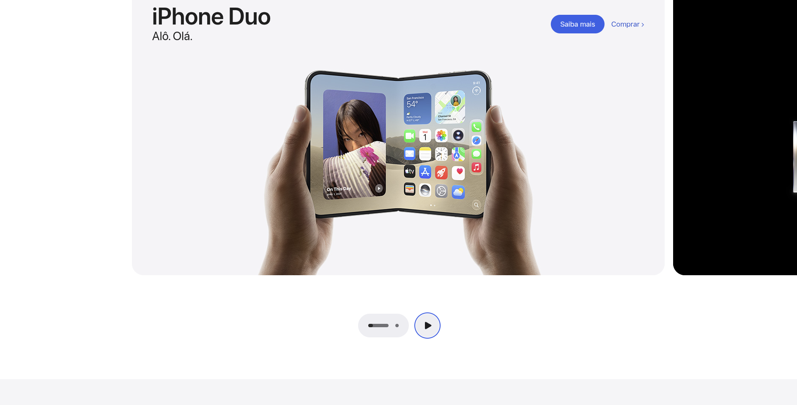
*Figura 6.2 — Presença de controles explícitos de paginação e botão de **Reproduzir / Pausar** logo abaixo da animação do iPhone Duo, permitindo ao usuário interromper movimentos automáticos a qualquer momento (WCAG 2.2.2).*

!!! info "Conclusão fundamentada da Etapa 6 (15 de 17 critérios atendidos — 88%)"
    O portal atende com excelência aos requisitos de **Nível A e AA** desta etapa: botões de ícone possuem rótulos acessíveis precisos em português (Figura 6.1), títulos são renderizados em texto HTML real, não há áudios automáticos nem flashes perigosos, e todas as animações contam com botão visível de pausa (Figura 6.2). Os 2 únicos critérios não atendidos pertencem ao **Nível AAA**: ausência de janela de interpretação em **Libras** nos vídeos pré-gravados e ausência de resumo/explicação complementar para termos técnicos em páginas densas.

---

## Etapa 7 — Usabilidade: As 10 Heurísticas de Jakob Nielsen

  

    🔍
    
<h2>Inspeção Heurística Guiada por Tarefas e Fluxos</h2>

  

  
Avaliação analítica dos 20 critérios referentes às 10 Heurísticas de Usabilidade de Nielsen durante a execução das tarefas de descoberta de especificações, comparação de modelos, localização de lojas e gerenciamento da sacola.

  

    

      <h3>Procedimentos de Inspeção</h3>
      <ul>
        <li>Análise da visibilidade de informações críticas na vitrine de produtos (<strong>Heurística 6 — Reconhecimento em vez de memorização</strong>).</li>
        <li>Teste de reversibilidade, remoção de produtos e prevenção de erros na sacola (<strong>Heurísticas 3, 5 e 9</strong>).</li>
        <li>Verificação da consistência visual e estética minimalista em todo o domínio (<strong>Heurísticas 4 e 8</strong>).</li>
      </ul>
    

    

      <h3>Cruzamento com o Teste de Usuário</h3>
      <ul>
        <li>Os achados da inspeção heurística foram confrontados com as dificuldades reais observadas na sessão com a participante P1 (documentada na seção <a href="../entrevista.html">Entrevista</a>).</li>
      </ul>
    

  

### Evidências e conclusões — Etapa 7

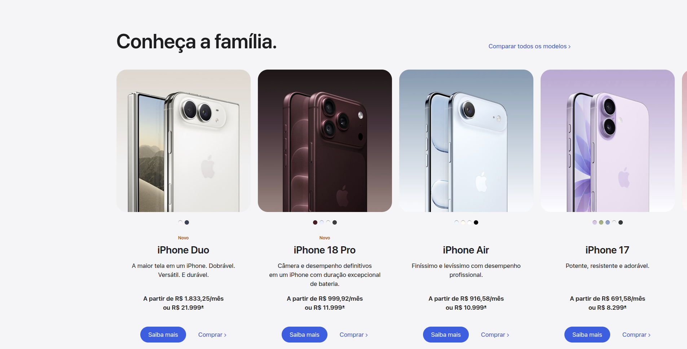
*Figura 7.1 — Vitrine "Conheça a família" na página do iPhone: embora apresente estética minimalista (Heurística 8), exibe apenas frases promocionais curtas e omite as especificações técnicas básicas de cada aparelho na listagem principal, exigindo que o usuário localize o link secundário "Comparar todos os modelos >" no canto superior direito.*

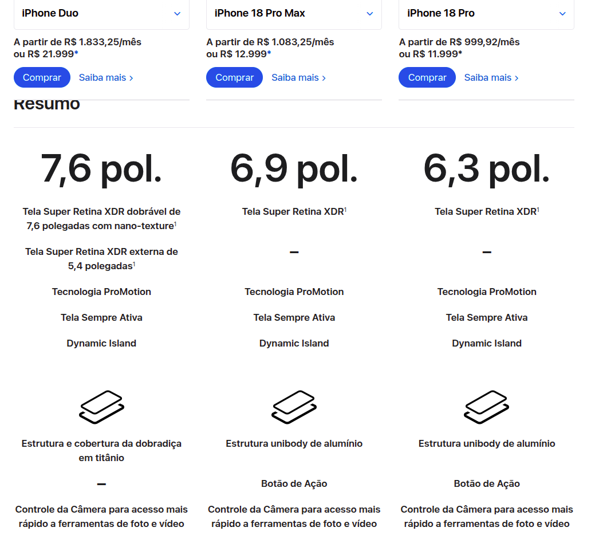
*Figura 7.2 — Ferramenta de comparação lado a lado (iPhone Duo, iPhone 18 Pro Max e iPhone 18 Pro): uma vez localizada, apoia bem o reconhecimento em vez da memorização ao alinhar tamanho de tela, estrutura e recursos em colunas paralelas.*

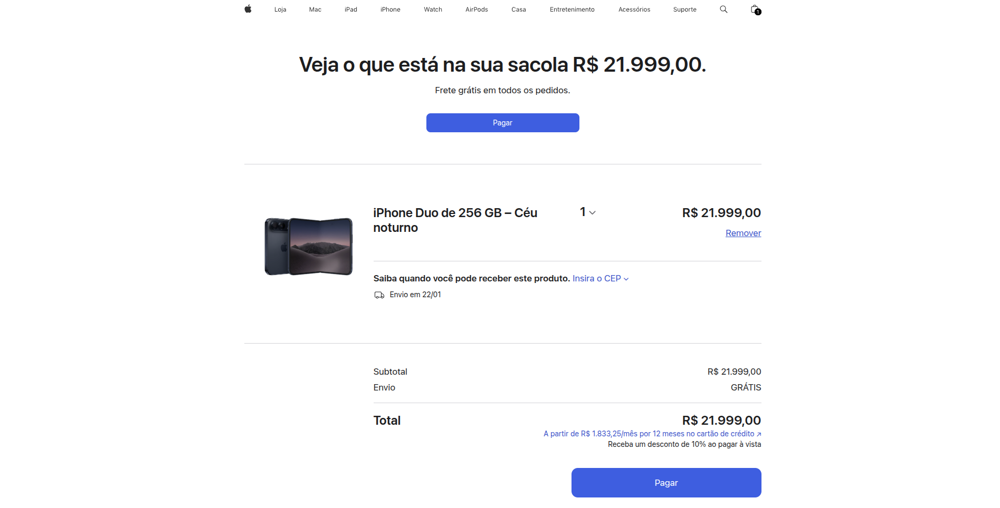
*Figura 7.3 — Tela da sacola de compras evidenciando controle e liberdade do usuário (Heurística 3, com seletor de quantidade e botão claro "Remover") e prevenção de erros antes de finalizar a compra (Heurística 5, com discriminação de subtotal, frete grátis e desconto à vista).*

!!! warning "Conclusão fundamentada da Etapa 7 (10 de 20 critérios atendidos — 50%)"
    A avaliação heurística registrou o menor índice percentual entre as etapas (**50%**), revelando um *trade-off* clássico no design da Apple: o foco extremo em **Estética e Design Minimalista (Heurística 8)** e **Consistência Visual (Heurística 4)** por vezes sacrifica o **Reconhecimento Imediato de Informações (Heurística 6)** e a **Clareza de Caminho/Rótulos (Heurística 2)**. Essa conclusão da inspeção técnica foi validada na prática durante a entrevista com usuário real, na qual a participante P1 falhou justamente na Tarefa 1 (encontrar as características técnicas na vitrine da Figura 7.1) e relatou confusão ao buscar lojas físicas pelo menu.

---

## Limitações do método

- A amostra cobre os fluxos principais de descoberta, comparação, compra/sacola e suporte de `apple.com/br`, e não a totalidade das páginas do domínio.
- Ferramentas automáticas (Lighthouse e WAVE) detectam apenas uma fração dos problemas de acessibilidade; por isso todas as etapas combinaram inspeção manual de código com testes interativos e validação com usuário real.

Para conhecer o funcionamento detalhado de cada instrumento utilizado nesta auditoria, acesse a seção [Ferramentas](../ferramentas/devtools.md).

  

    Próxima página
    <h3>Resultado da Análise</h3>
    
Veja a consolidação dos índices de aprovação por nível WCAG, por etapa e o relatório completo em PDF.

  

  

    <a class="step-nav-btn secondary" href="index.html">Visão geral</a>
    <a class="step-nav-btn primary" href="resultados.html">Continuar →</a>
  

